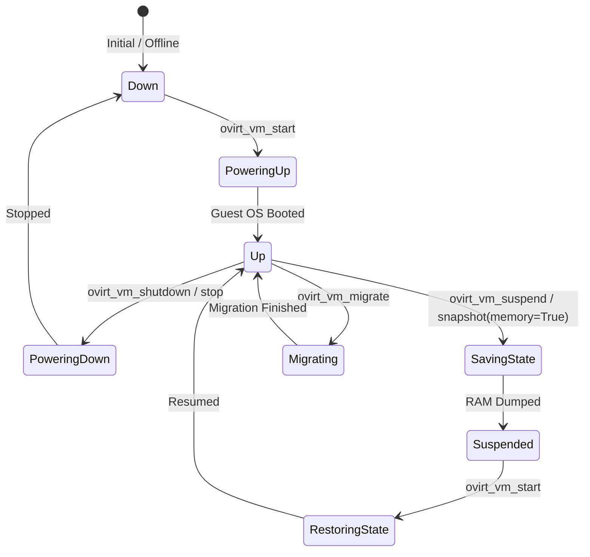

# oVirt / OLVM Pre-flight Status Guards & Lifecycle State Machine Safety

This document explains the architectural principles, state machines, and built-in **Pre-flight Status Guards** implemented in `ovirt-mcp`. It explains **why** certain operations fail in oVirt, what transitional states mean, and how the MCP server automatically prevents engine conflicts and data corruption.

---

## 1. Executive Summary: The "WebAdmin vs. REST API" Problem

If you have ever used the oVirt / Oracle Linux Virtualization Manager (OLVM) WebAdmin graphical user interface, you have certainly noticed that **buttons are constantly greyed out and disabled**:
- You cannot click **"Enroll Certificate"** or **"Upgrade"** while a host is powered on (`up`).
- You cannot click **"Create Template"** or **"Restore Snapshot"** while a virtual machine is running (`up`).
- You cannot click **"Console"** when a virtual machine is powered off (`down`).
- You cannot take a **Memory Snapshot** when the machine is shut down.
- While a VM is booting up (`powering_up`), saving RAM to disk (`saving_state`), or when a disk is being copied (`image_locked`), almost all operational buttons are completely disabled.

### Why does the WebAdmin GUI disable these buttons?
Because the underlying hypervisor engine (`ovirt-engine`) enforces strict state-machine rules called **`CanDoAction` validations**. Executing actions in an illegal or transitional state will either:
1. Cause an immediate engine backend failure (HTTP 409 Conflict or HTTP 400 Bad Request).
2. Trigger transient VDSM socket disconnects, unhandled timeouts, or backend engine race conditions.
3. Potentially corrupt storage metadata (such as QCOW2 volume chains or LVM lock leases).

### The REST API Blind Spot
Unlike the WebAdmin GUI, the raw oVirt REST API and Python SDK **do not grey out functions**. If an AI agent or automated script calls `enroll_certificate()` on a running hypervisor or `create_template()` on a running VM, the API accepts the HTTP request, attempts backend execution, and then fails abruptly with cryptic error messages like:
```text
Fault reason is "Operation Failed". Fault detail is "[Cannot create Template. VM is running.]". HTTP response code is 409.
```

### The `ovirt-mcp` Solution
`ovirt-mcp` implements centralized **Pre-flight Status Guards**. Before any mutation request is dispatched to the oVirt Engine, the MCP server evaluates the live operational state of the target entity (Host, VM, Disk, Storage Domain, Template, or Snapshot).
- **Fast Rejection (<5ms):** Rejects invalid calls before wasting engine CPU or network round-trips.
- **Transitional State Protection:** Completely locks out operations while resources are in ephemeral states (`reboot`, `installing`, `saving_state`, `image_locked`).
- **Human-Readable Remediation:** Translates cryptic engine codes into plain English guidance explaining exactly what state is needed and what to do next.

---

## 2. Entity Lifecycle State Machines Explained



### 2.1 Hypervisor Hosts (`ovirt_host_*`)

| State Category | Statuses | Operational Meaning |
| :--- | :--- | :--- |
| **Stable Active** | `up` | Host is healthy, connected to engine, running active VMs, and handling workloads. |
| **Stable Inactive** | `maintenance`, `non_operational`, `down` | Host is cordoned from running VMs. Safe for firmware upgrades, network changes, and OS patches. |
| **Transitional (Locked)** | `reboot`, `installing`, `preparing_for_maintenance`, `kdumping`, `connecting`, `initializing` | Host is in the middle of a hardware/software transition. **All mutations are strictly blocked.** |

#### Real-world Examples:
- **Why PKI Certificate Enrollment requires `maintenance`:**  
  Enrolling a new TLS certificate (`ovirt_host_enroll_certificate`) restarts the VDSM daemon on the host. If VMs are running or the host is `up`, the engine could lose its heartbeat socket, misinterpreting the host as dead and fencing it.
- **Why Host OS Upgrades require `maintenance`:**  
  Applying kernel patches and package updates requires evacuating all virtual machines first. Attempting an upgrade while active will fail engine pre-flight checks.

---

### 2.2 Virtual Machines (`ovirt_vm_*`)

| State Category | Statuses | Operational Meaning |
| :--- | :--- | :--- |
| **Stable Active** | `up`, `paused`, `suspended` | Guest OS is executing or held in memory. |
| **Stable Inactive** | `down` | Virtual machine is powered off. Underlying storage is quiescent. |
| **Transitional (Locked)** | `powering_up`, `powering_down`, `wait_for_launch`, `reboot_in_progress`, `saving_state`, `restoring_state`, `image_locked`, `migrating` | Machine state or storage volumes are currently in flux. |

#### Real-world Examples:
- **Why Template Creation strictly requires `down`:**  
  Creating a reusable golden image (`ovirt_template_create_from_vm`) freezes and clones all disk images to create a master template. If the VM were running, writes in memory would lead to file system corruption in the golden image.
- **Why VM Exports require `down`:**  
  Exporting a VM as an OVA or to an Export Storage Domain copies the full disk payload. Active QEMU write locks will cause HTTP 409 Conflict.
- **Why Console Tickets require `up`:**  
  A SPICE or VNC console ticket connects to the active QEMU hypervisor process. If the machine is powered off, no socket exists.

---

### 2.3 Snapshots (`ovirt_vm_snapshot_*`)

| Snapshot Type | Allowed VM Status | Prohibited VM Status | Reason |
| :--- | :--- | :--- | :--- |
| **Disk-only Snapshot** | `up`, `down`, `paused` | `image_locked`, `saving_state`, `migrating` | Takes a live QCOW2 snapshot overlay or offline copy. |
| **Memory Snapshot (`persist_memory=True`)** | Strictly `up` or `paused` | `down`, `powering_up`, `saving_state` | Dumps the active RAM pages of the VM. If the VM is `down`, there is no RAM to save! |
| **Snapshot Restore (`revert`)** | Strictly `down` | `up`, `paused`, `image_locked` | Reverts the active disk pointer to the historical snapshot. The VM must be stopped. |
| **Snapshot Preview** | Strictly `down` | `up`, `paused`, `image_locked` | Mounts the historical snapshot volume for inspection. Requires offline VM. |

---

### 2.4 Virtual Disks (`ovirt_disk_*`)

oVirt disks have three primary states:
1. `ok`: The disk volume is unlocked, synchronized, and ready for read/write or management operations.
2. `locked`: An operation (resize, snapshot merge, move, clone, copy, or sparsify) is actively running on the volume.
3. `illegal`: An operation failed midway or the volume failed consistency checks.

> [!CAUTION]
> **The Disk Lock Rule:** Never execute an operation on a `locked` disk. If a disk is resized or detached, oVirt locks the underlying LVM / QCOW2 image until metadata is updated. Calling `move_disk` or `delete_disk` during this window will corrupt storage leases.

---

## 3. How the Guards Work in `ovirt-mcp`

The guards are centralized in `src/ovirt_mcp/tools/guards.py`. When an action is invoked, the guard runs:

```python
require_vm_status(
    vm_name="ProductionDatabase",
    current_status=vm.status,
    allowed_statuses=("down",),
    action_name="export_vm",
)
```

If the VM is currently `up`, the guard raises an `OvirtValidationError`:
```text
Cannot execute 'export_vm' on VM 'ProductionDatabase': Current status is 'up'. 
oVirt requires the VM to be in one of the following states: 'down'. 
Please stop the virtual machine first before executing this operation.
```

If the entity is in a transitional state (e.g. `image_locked` or `saving_state`), the guard adds an explicit warning:
```text
Operations are strictly blocked while the virtual machine is in an ephemeral transitional state (e.g. saving state, restoring, or image locked).
```

---

## 4. Troubleshooting & Remediation Guide

When you encounter a Status Guard rejection, follow this simple remediation guide:

| Guard Rejection Message | Why It Occurred | How to Fix / Proceed |
| :--- | :--- | :--- |
| `oVirt requires the host to be in: 'maintenance', 'non_operational'` | You called a maintenance operation (`enroll_certificate`, `upgrade`, `reinstall`) on an active host. | Call `ovirt_host_maintenance(name_or_id="...", confirm=True)` first to cordon the host. |
| `oVirt requires the VM to be in: 'down'` | You called an offline operation (`create_template_from_vm`, `export_vm`, `restore_vm_snapshot`, `preview_vm_snapshot`) on a running machine. | Call `ovirt_vm_shutdown` or `ovirt_vm_stop(name_or_id="...", confirm=True)` first. |
| `oVirt requires the VM to be in: 'up'` | You requested a live resource (`get_vm_console_ticket`, `start_vm_backup`, `suspend_vm`, `reset_vm`) on a powered-off VM. | Call `ovirt_vm_start(name_or_id="...")` and wait for the OS to boot before retrying. |
| `oVirt requires the VM to be in: 'up', 'paused'` (Memory Snapshot) | You passed `persist_memory=True` to `create_vm_snapshot` while the machine is offline. | Set `persist_memory=False` for offline disk snapshots, or power the VM on first. |
| `Operations are strictly blocked while the disk is currently locked` | A previous disk resize, detach, or copy operation is still finalizing on the storage domain. | Wait 5–15 seconds for the engine background task to finish and retry. |
| `oVirt requires the storage domain to be: 'active'` | You attempted to create a disk or update OVF store on an inactive or maintenance domain. | Activate the storage domain using `ovirt_storage_domain_activate` first. |

---

## 5. Complete Matrix of Protected Tools

| Module | Protected Tool | Enforced Pre-flight Requirement |
| :--- | :--- | :--- |
| **`hosts.py`** | `ovirt_host_enroll_certificate` | Host must be in `maintenance`, `install_failed`, or `non_operational`. |
| | `ovirt_host_maintenance` | Host must not already be in `maintenance` or transitional states. |
| | `ovirt_host_activate` | Host must be in `maintenance`, `non_operational`, `unassigned`, or `down`. |
| | `ovirt_host_upgrade` | Host must strictly be in `maintenance`. |
| | `ovirt_host_refresh` / `sync_networks` | Host must be `up`, `maintenance`, or `non_operational` (not `down` or `reboot`). |
| **`vms.py`** | `ovirt_vm_snapshot_create` (Memory) | VM must strictly be `up` or `paused`. |
| | `ovirt_vm_snapshot_restore` / `preview` | VM must be `down`; snapshot must be `ok`. |
| | `ovirt_vm_snapshot_commit` / `undo` | Snapshot must strictly be `in_preview`. |
| | `ovirt_vm_suspend` / `reset` | VM must strictly be `up`. |
| | `ovirt_vm_delete` / `clone` | VM must strictly be `down`. |
| | `ovirt_vm_cancel_migration` | VM must strictly be in `migrating` status. |
| **`disks.py`** | `ovirt_disk_resize` / `move` / `copy` / `delete` | Disk must strictly be `ok` (blocks `locked` and `illegal`). |
| | `ovirt_disk_attach` / `detach` | VM must be stable (`up`, `down`, `paused`); disk must be `ok`. |
| **`storage.py`** | `ovirt_storage_domain_update_ovf_store` | Domain must strictly be `active`. |
| | `ovirt_storage_domain_detach` | Domain must strictly be in `maintenance`. |
| **`templates.py`** | `ovirt_template_create_from_vm` | Source VM must strictly be `down`. |
| | `ovirt_template_delete` / `export` / `update` | Template must strictly be `ok` (not `locked`). |
| **`backups.py`** | `ovirt_vm_backup_start` | VM must strictly be `up` (QEMU CBT live socket requirement). |
| **`compute.py`** | `ovirt_vm_ticket` / `console_file` | VM must strictly be `up`. |
